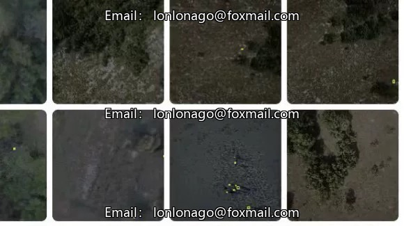
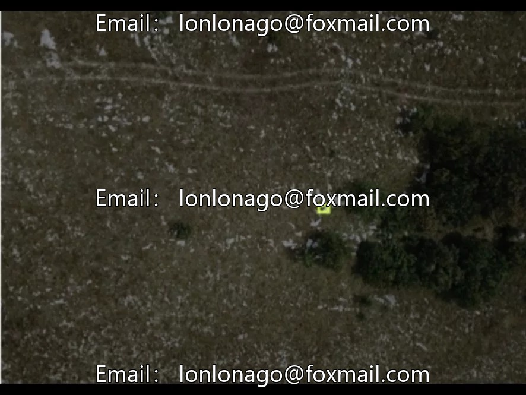
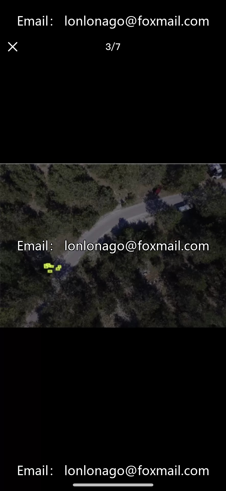
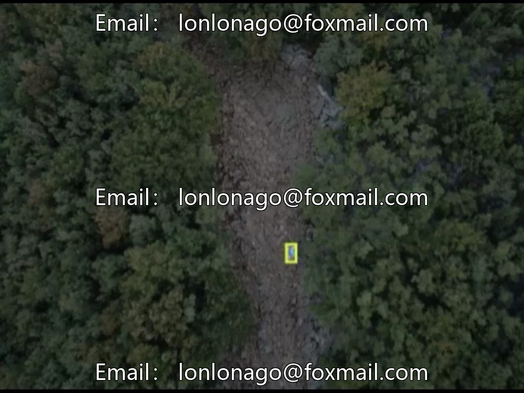
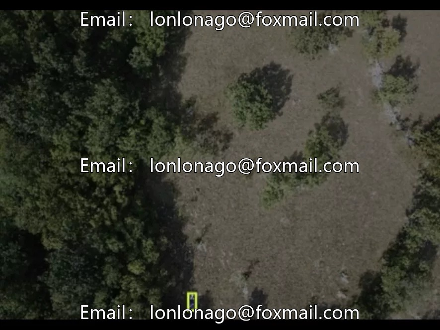

# Drone inspection and aerial photography rescue dataset, drone human detection dataset, 1600 images

## Body

Drone inspection and aerial photography rescue dataset, drone human detection dataset, 1600 images, only labeled "person" (human), belongs to target detection dataset, suitable for low-altitude drone operations, security monitoring, search and rescue positioning, crowd density statistics, etc.

The dataset format is an image file (JPG/PNG) + annotation file (XML/JSON). There is no model at present, and basic image resources can support the training of algorithms. It can be expanded in the future.

Virtual materials, once sold, are non-refundable.
Interested friends, click "I want" to proceed.

## Images

## Payment

Here is a pay link on Stripe ( https://buy.stripe.com/3cs8yP7sY87d0vu9AB ). Please contact me lonlonago@foxmail.com after funding $89, and I will send you a complete data files , thank you!

